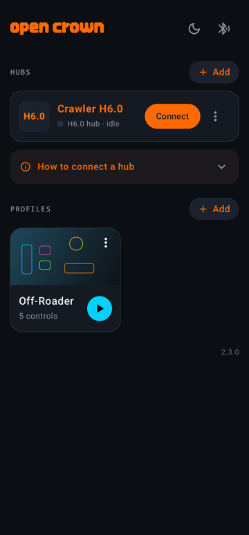
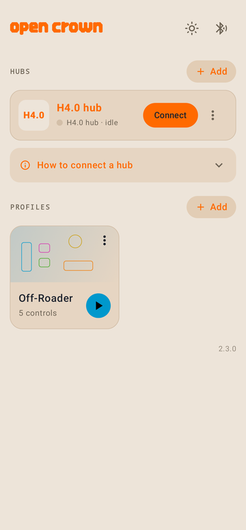
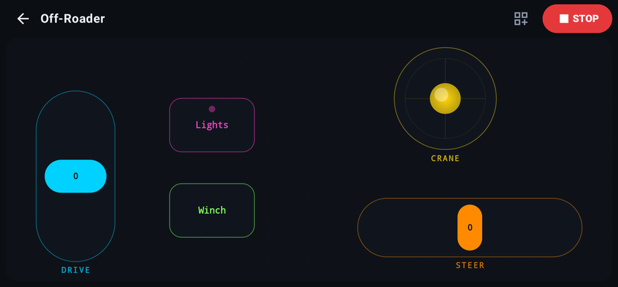
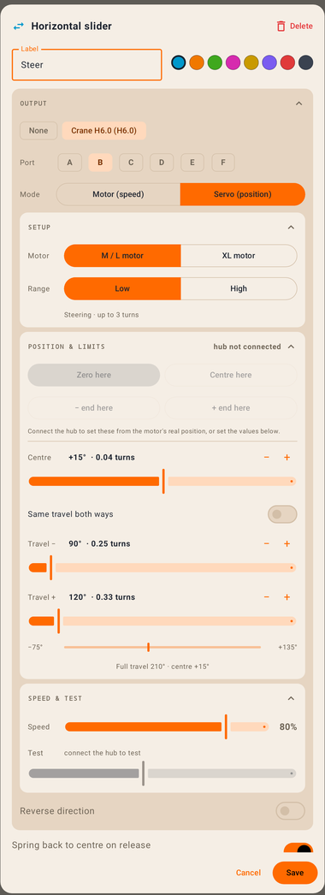
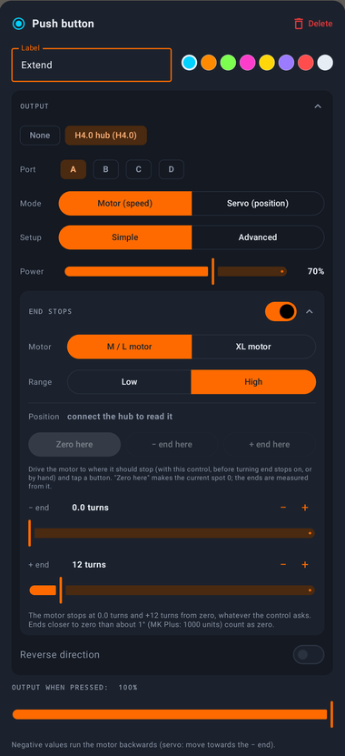
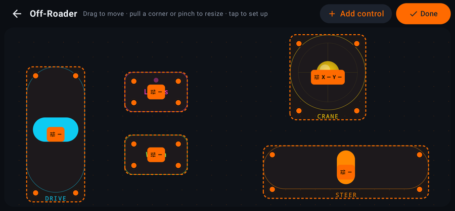

<p align="center">
  
</p>

<h1 align="center">OpenCrown</h1>

<p align="center">
  An open-source Android app for driving Mould King hubs and battery boxes with your own control layouts:<br>
  joysticks, sliders, buttons and toggles, placed and sized however you like.
</p>

> **Unofficial project.** OpenCrown is not affiliated with, endorsed by or supported by Mould King.
> "Mould King" is used only to say which hardware the app works with.

<p align="center">
  
  &nbsp;
  
</p>
<p align="center">
  
</p>

## Features

**Hubs**
- **H4.0 and H6.0 hubs** (the 6-pin "Powered Up style" hubs that advertise as `YX-01…`, `YX-02…`, `YX-05…`, `YX-06…`), connected over Bluetooth.
- **Classic 6.0 and 4.0 modules**, including older 4.0 boxes that only switch motors on and off. These are controlled by Bluetooth advertising, so several can run at once.
- Several hubs in one layout, a big **STOP** button, and a connection log you can copy when something misbehaves.

**Layouts**
- Profiles with joysticks, vertical and horizontal sliders, push buttons and toggle switches.
- Edit mode: drag to move, pull a corner or pinch to resize, everything snaps to the grid.
- Spring-back or stay-put controls, per-control colours and labels, light and dark theme.

**Motors** (per output)
- *Simple*: one power limit.
- *Advanced*: a separate top speed for reverse (sliders then rest in proportion, so equal moves give equal speed changes), and smooth acceleration with an adjustable ramp time.
- *End stops* (H4.0/H6.0 + Mould King smart motor): the hub itself stops the motor at two set positions, e.g. for a crane boom or a linear actuator, while other motors keep running.

**Servo (position) mode** for smart motors on H4.0/H6.0
- Zero, centre and end points set from the motor's live position, or typed in.
- Low range (steering, up to 3 turns, in degrees) or High range (actuators, up to 1000 turns).
- Adjustable speed, a test slider, and sliders that rest where the centre lies in the travel.

<p align="center">
  
  &nbsp;
  
</p>
<p align="center">
  
</p>

## Install

1. Download the latest `OpenCrown-x.y.z.apk` from [Releases](https://github.com/matakobrynky/OpenCrown/releases).
2. Open it on your phone. Android will ask you once to allow installing apps from your browser or file manager.
3. Allow **Nearby devices** (Bluetooth) when the app asks.

Requires Android 8.0 or newer with Bluetooth LE.

## Getting started

1. **Hubs → Add.** For an H4.0/H6.0 hub, switch the hub on and tap **Find hub**. For a classic module, pick its type and number.
2. **Connect** the hub.
3. **Profiles → Add**, open the profile, tap the edit button and add controls.
4. Tap a control in edit mode to choose its hub, port and mode, then tap **Done** and drive.

## Building from source

You need JDK 17 and the Android SDK (platform 35). Then:

```sh
./gradlew testDebugUnitTest   # unit + screenshot tests
./gradlew assembleDebug       # app/build/outputs/apk/debug/app-debug.apk
```

### Signed release builds

Release builds are signed only if a `keystore.properties` file is present in the project root
(it is git-ignored, as are `*.jks` files; **never commit them**):

```properties
storeFile=opencrown-release.jks
storePassword=…
keyAlias=opencrown
keyPassword=…
```

Put the keystore next to it and run `./gradlew assembleRelease`. Without the file you get an unsigned
release APK. Android only installs an update over an existing install if it is signed with the same key.

## How it works

**H4.0 / H6.0 hubs** use a Bluetooth LE GATT service (`…ae3a…`). The app writes to `…ae3b…` and listens on
`…ae3c…`. Messages are ASCII frames: `T` + data length (2 hex) + command + data + `W`, for example `T00CW`.

| Command | Meaning |
|---|---|
| `1` | connect (`T041AABBW`) |
| `2` | disconnect |
| `C` | heartbeat (sent every second; the reply also says which ports have a smart motor) |
| `4` | speed of every port: per port a limit flag (1 hex) + speed (4 hex, bit 15 = reverse) |
| `3` | position (servo) target of every port |
| `8` | set the current position as zero |
| `A` | read a port's position |
| `9` | end points of a port, used by the limit flag of command `4` |
| `F` | stall protection on/off |

Smart-motor positions are in hub units: 395 000 per output turn for M/L motors, 590 000 for XL.

**Classic modules** are not connected at all: the app broadcasts their commands in Bluetooth advertising
packets (manufacturer data `0xFFF0`, encoded the way the modules expect).

The H-hub protocol was worked out for interoperability by observing how the official app talks to the hubs.
No code, images or other assets from the official app are included in this repository. The classic-module
telegram format follows [mkconnect-python](https://github.com/J0EK3R/mkconnect-python), whose published
capture is used as a test reference.

### Project layout

```
app/src/main/java/io/github/matakobrynky/opencrown/
  data/   profiles, controls, hub settings (stored as JSON)
  mk/     Bluetooth: hub protocol and driver, classic-module advertising, motor shaping
  ui/     Compose screens: home, driving / layout editor, control settings, Bluetooth inspector
app/src/test/   protocol tests and screenshot tests (Robolectric)
```

## Contributing

Bug reports with a copied connection log (hub card → ⋮ → **Copy log**) are the most useful thing you can send.
Pull requests are welcome.

## License

[MIT](LICENSE) © 2026 matakobrynky. The classic-module encoding is ported from mkconnect-python
(MIT, © 2024 J0EK3R); see [THIRD_PARTY_NOTICES.md](THIRD_PARTY_NOTICES.md).
